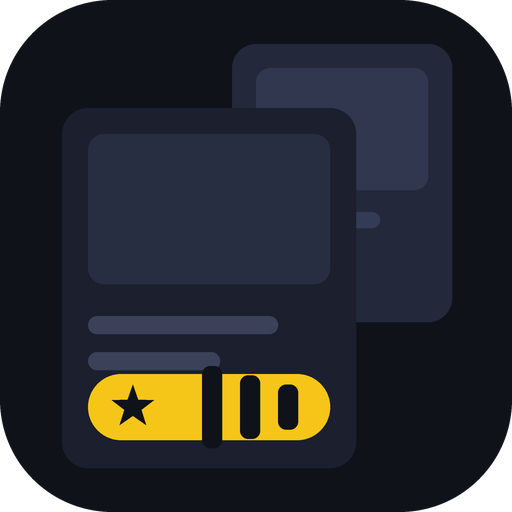

# PosterX

Un catálogo de películas y series para **Kino** cuyas imágenes llevan la **nota incrustada** (IMDb,
Rotten Tomatoes, Metacritic, Trakt, Letterboxd…), gracias a
[RatingPosterDB](https://ratingposterdb.com/) o a [OpenPosterDB](https://openposterdb.com).



**No reproduce nada.** Es un catálogo para descubrir qué ver: cuando abres uno de sus títulos, Kino te
ofrece **"Buscar dónde verlo"** y lo busca en tus otras fuentes.

## Qué añade a Kino

- **Su propia sección**, con seis pestañas: *Películas*, *Series*, *Tendencias de hoy*, *Populares*, *Mejor
  valoradas* y *Géneros*. En la tele es una entrada del menú lateral; en el celular, un chip en Inicio.
- **Mosaicos en Categorías**: doce géneros que se abren como lista paginada, con el arte de cada mosaico
  también con nota.
- **Filas en Inicio**: **Anime**, **Documentales**, **Infantil** y **Doramas**, más tendencias, mejor
  valoradas, en cines, al aire y próximos estrenos. Sin repetir títulos entre filas.
- **Sus categorías en el Inicio**: sus títulos aparecen en las filas de categoría de Kino —**Anime**,
  **Infantil**, **Documentales** y las de género (Acción, Comedia, Drama, Terror…)—, junto a los de tus
  otras fuentes.
- **Búsqueda propia** en todo el catálogo de TMDB, con "Ver más" para seguir mirando.
- **Fichas completas**: sinopsis, nota, año, temporadas y capítulos.
- **Imágenes con nota**: el póster, el fondo y los fotogramas de capítulo.
- **Rellena el póster de un título ajeno** cuando su fuente no trae ninguno.

Si usas el **Home por categorías** de Kino (*Ajustes ▸ App*), el catálogo se integra: los títulos llevan
sus géneros, así que llenan las filas de Acción, Comedia, Drama y compañía.

## Instalarlo

Aparece en **Plugins ▸ De la comunidad**. También se instala a mano:

1. Abre Kino.
2. Ve a **Ajustes ▸ Plugins** (en el televisor: menú ☰ → **Plugins**).
3. Toca el botón **+**.
4. Escribe:

   ```
   gregorysteventt-source/kino-rpdb-catalog
   ```

5. **Agregar** → lee la hoja → **Instalar**.

En la hoja de consentimiento Kino avisa de los dos servidores de imágenes con los que habla el plugin. La
clave que viene puesta es **pública y gratuita**. Si algún día pones la tuya —por ejemplo la de pago de
RatingPosterDB— ten en cuenta que se guarda como un ajuste más, **sin cifrar**: no la compartas.

## Configurarlo

Viene **puesto para funcionar**: instalas y ya hay notas, sin registrarte en ningún sitio y sin escribir
nada. La configuración va en cuatro bloques.

### Servidor

| Ajuste | Qué hace |
| --- | --- |
| **Servidor de imágenes** | Una lista con dos: **OpenPosterDB (gratis)** y **RatingPosterDB**. Nada de escribir direcciones. |
| **Clave del servidor** | Viene puesta `t0-free-rpdb`, la clave pública gratuita de OpenPosterDB. Cámbiala si usas otro servidor o sacas la tuya. Si pones una clave personal, no la compartas: se guarda con tus ajustes. |

### Póster (en la tele)

El póster es **vertical** y se ve en el celular y en las fichas, así que tiene sus propios ajustes:

| Ajuste | Qué hace |
| --- | --- |
| **Qué notas** | Cuáles salen en el póster. Por defecto, IMDb, Rotten Tomatoes y Metacritic. |
| **Tamaño de la nota** | `Grandes` (recomendado), `Muy grandes` o `Medianas`. Con tres notas se encoge solo, para que quepan en una fila. |
| **Póster sin el título** | Quita el texto del arte. Como las notas van abajo, **dejan de tapar el título impreso**. Viene apagado. |
| **Tipo de póster** | `poster-default`, o el tipo con nota que incluya tu plan (por ejemplo `poster-imdb-rated`). |

### Fondo y capítulos (en la tele)

Son **apaisados** —el fondo es el de las tarjetas del Inicio— y aguantan más notas que un póster:

| Ajuste | Qué hace |
| --- | --- |
| **Qué notas** | Las mismas opciones, y **pueden ser distintas de las del póster**. Incluye `Todas las que haya (hasta 8)`. |
| **Tamaño de la nota** | `Grandes` (recomendado), `Muy grandes (imagen 4K, pesada)` o `Medianas`. |
| **Dónde va la nota** | Ocho sitios. Por defecto, **centrada a la derecha**. |

### Diagnóstico

Una línea que dice **qué está funcionando**, y un botón **"Probar el servidor"** que lo comprueba de cero
en el momento, sin tener que adivinar si la clave quedó bien.

### Qué notas salen

En *Qué notas*, dentro de cada bloque, eliges **cuáles** y, de paso, **cuántas**:

| Opción | Notas |
| --- | --- |
| `Solo IMDb (estricto)` | Solo IMDb, aunque algún capítulo se quede sin nota (ver abajo) |
| `IMDb y Rotten Tomatoes` | Dos, y más grandes |
| `IMDb y RT (+ MAL en anime)` | IMDb, RT y **MyAnimeList** cuando es anime |
| `IMDb, RT y Metacritic` (por defecto) | Tres, siempre las mismas fuentes |
| `IMDb y si no hay, TMDB` | Una nota siempre, IMDb cuando exista |
| `Automático (hasta 3)` | Lo que tenga el servidor, en su orden |

Conviene saber dos cosas del servidor, porque no son culpa del plugin:

- **MyAnimeList solo puntúa anime.** En una película no existe y el servidor pasa a la siguiente fuente,
  así que en anime sale `MAL` primero, que es lo suyo.
- **Letterboxd puntúa sobre 5**, y las demás sobre 10 o en porcentaje. En `Automático` una película puede
  salir con tres escalas distintas en la misma fila. Por eso existe `IMDb y RT (+ MAL en anime)`, que la
  deja fuera.

Y sobre **`Solo IMDb (estricto)`**: el servidor recorre sus fuentes en orden y cae a la siguiente cuando la
primera no tiene dato, así que para quedarse solo con IMDb hay que excluir las demás. La consecuencia es
que **un capítulo sin nota de IMDb se queda sin ninguna nota**. Pasa en pocas series, pero pasa.

### Los pósters, en tu idioma

Los pósters llegan **en el idioma de Kino**: en español, en **español de Latinoamérica**; en inglés, en
inglés. No hay nada que configurar y vale para la tele y para el celular.

## Qué servidor elegir

| | [RatingPosterDB](https://ratingposterdb.com/api-key/) | [OpenPosterDB](https://openposterdb.com) |
| --- | --- | --- |
| **Pósters** con nota | Sí | Sí |
| **Fondos** con nota | Solo en su plan de pago | **Sí, gratis** |
| **Fotogramas** con nota | Solo en su plan de pago | **Sí, gratis** |
| **Clave** | La tuya, desde su web | **`t0-free-rpdb`**, una clave pública gratuita |
| **En la lista de ajustes** | `RatingPosterDB` | `OpenPosterDB (gratis)` — **viene elegido** |

**Con OpenPosterDB no hace falta registrarse ni pagar nada.** Si algún día quieres tu propia clave (la
pública va compartida y puede ir más lenta), la sacas en su web y cambias solo ese campo.

**Si prefieres RatingPosterDB**, elige `RatingPosterDB` en la lista y pega tu clave personal. Los dos
servidores usan las mismas direcciones, así que cambiar de uno a otro son dos toques.

Si te equivocas al escribir una clave, el plugin lo detecta y **vuelve a las imágenes de TMDB** en vez de
dejarte cientos de imágenes rotas.

## Qué imágenes pueden llevar nota

| Imagen de Kino | ¿Se puede? |
| --- | --- |
| **Póster** (vertical, el del móvil y las fichas) | **Sí** |
| **Fondo** (horizontal: el de las tarjetas del Inicio) | **Sí**, si tu servidor los sirve |
| **Fotograma** de capítulo | **Sí**, si tu servidor los sirve |
| **Logo** | **No.** Kino no tiene ese campo para un título: solo lo admite como imagen de un canal en vivo. |

**El plugin comprueba antes de usar.** En RatingPosterDB los fondos con nota son de un plan de pago: si se
le piden con una clave que no los incluye, no devuelve la imagen — y como en un televisor Kino dibuja las
tarjetas **con el fondo**, la pantalla entera se quedaría en blanco. Por eso el plugin **pregunta primero**
si tu servidor sirve ese tipo de imagen, y si no, esa imagen la pone TMDB. No hay nada que ajustar.

**No necesitas llave de TMDB.** En Kino 0.9.53 o superior, Kino pone la suya: de ahí salen las fichas, las
sinopsis y cualquier imagen que el servidor no sirva.

## Si el fondo se ve suave

El fondo de OpenPosterDB es de **1920×1081**, perfecto para una tele 1080p. Si tu televisor es **4K** y lo
notas blando a pantalla completa, pon `Fondo y capítulos ▸ Tamaño de la nota ▸ Muy grandes`: además de
notas mayores, pide la imagen a 3840×2160. Ojo, esas imágenes pesan **1,25 MB** cada una en vez de 172 KB,
así que solo vale la pena si de verdad tienes 4K.

## Lo que este plugin NO hace

- **No cambia las imágenes de tus otras fuentes.** Aporta su propio catálogo. Eso sí: si un título ajeno no
  trae póster ninguno, este plugin se lo rellena.
- **No reproduce.** Sus títulos van a "Buscar dónde verlo", en tus otras fuentes.
- **No pone logos.** Kino no tiene ese campo para un título.
- **No trae la clave del servidor.** La pones tú (y viene una gratuita puesta).
- **No añade canales en vivo.**

## Si algo no va

| Lo que ves | Qué hacer |
| --- | --- |
| *Este plugin necesita una versión más nueva de Kino* | Tu Kino es anterior a la 0.9.50. Actualízalo. |
| Los pósters salen sin nota | Revisa **Configurar**: mira la línea de **Diagnóstico**, que dice si la clave vale y qué imágenes sirve el servidor. |
| En el televisor las tarjetas salen vacías | Desinstala y vuelve a instalar, para partir de ajustes limpios. Con el plugin recién instalado, el fondo se comprueba solo. |
| No aparecen las filas en Inicio | Ajustes ▸ Plugins ▸ **Actualizar**. Si siguen sin salir, activa **Modo debug** en la pestaña del plugin y mira el **Registro**. |
| Un póster no es el de ese título | TMDB usa listas de ids distintas para películas y series, y pueden coincidir en el mismo número. El plugin ya distingue de cuál se trata. Si vieras alguno mal, avisa a quien mantiene el plugin. |
| El plugin desaparece de la lista | Lo habrás desactivado o desinstalado: vuelve a agregarlo con la dirección de arriba. |

## Créditos

Sin afiliación con RatingPosterDB, OpenPosterDB, TMDB ni Kino.

- Las fichas, las sinopsis y las imágenes que el servidor no sirva son de **TMDB**, a través de Kino.
- Las imágenes con nota son de **RatingPosterDB** o de **OpenPosterDB**, con tu clave.
- La app es **Kino**.

Respeta los términos de cada servicio y no compartas tu clave con nadie.
